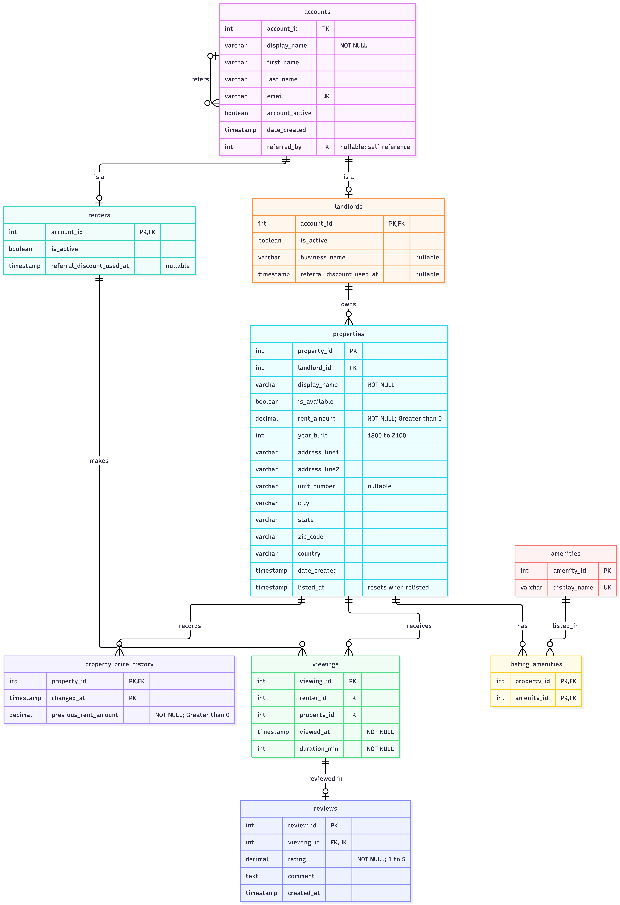

# Rental Marketplace Database
A relational database for managing a rental marketplace, including renter and landlord accounts, viewings, property amenities, and reviews.

**Author:** Mohamed Bouattour

**Chosen theme:** Rental Marketplace

## Domain

This project models the data needed by a rental marketplace. 
The database holds renter and landlord accounts, the properties landlords list, and tracks viewings, amenities, and reviews for each property.

Properties can offer multiple amenities that can be associated with many properties. 
A renter can go to multiple viewings, and an account can be a renter, a landlord, or both.

The database should be able to answer questions such as:
- What's the rent amount for available properties and where are they located?
- What are all the amenities offered by a particular property and which properties have a particular amenity?
- Which properties has a renter viewed? Which renters viewed a specific property? How often was a property viewed, and how much time did renters spend viewing it?
- How has a property's rent changed over time?
- What's the average rating for a property, based on renter reviews?

## Schema

Nine relations: `accounts` (with `renters` and `landlords` as subtypes), `properties`, `property_price_history`, `amenities`, `listing_amenities`, `viewings`, and `reviews`.

Worth noticing: `renters` and `landlords` overlap rather than being mutually exclusive, `accounts.referred_by` is a self-referencing foreign key, `property_price_history` is a weak entity, and deletions are `RESTRICT`ed (with an `is_active`/`is_available` flag instead) wherever history needs to survive.

Full details in [`schema/schema-definition.md`](schema/schema-definition.md) and [`schema/constraints.md`](schema/constraints.md).

## Entity Relationship Diagram

## Query Catalogue

| Query | Business question |
|---|---|
| [`q3_1.sql`](queries/unit3/q3_1.sql) | Exploratory queries establishing what the viewings data actually contains (statuses, filters, missing-value handling) before auditing the dashboard's failure-rate claim. |
| [`q3_2.sql`](queries/unit3/q3_2.sql) | Reproduces and fixes the two bugs behind the bad failure-rate number: rows silently dropped by a NULL-unsafe filter, and a `WHERE` clause referencing a `SELECT` alias that doesn't exist yet. |
| [`q3_3.sql`](queries/unit3/q3_3.sql) | The same "which renters viewed a disputed listing" question, answered three equivalent ways (subquery, CTE, set-based), with proof the three return identical rows. |
| [`4.1.1`](queries/unit4/q4_1.sql) | What does overall viewing activity look like platform-wide — count, total duration, average, min, max, and how many distinct renters? |
| [`4.1.2`](queries/unit4/q4_1.sql) | How many viewings does each property get, and what's their average duration? |
| [`4.1.3`](queries/unit4/q4_1.sql) | Same, but limited to properties with enough viewings for the numbers to mean anything — which properties have real signal behind their average? |
| [`4.1.4`](queries/unit4/q4_1.sql) | How does viewing volume and outcome break down by city? |
| [`4.2a`](queries/unit4/q4_2.sql) | For each property, how many viewings happened and how many of them failed? |
| [`4.2b`](queries/unit4/q4_2.sql) | What are the regional subtotals and the platform grand total for viewings and failures? |
| [`4.2c`](queries/unit4/q4_2.sql) | Among properties with enough viewings to trust their rate, what's a normal failure rate to measure others against? |
